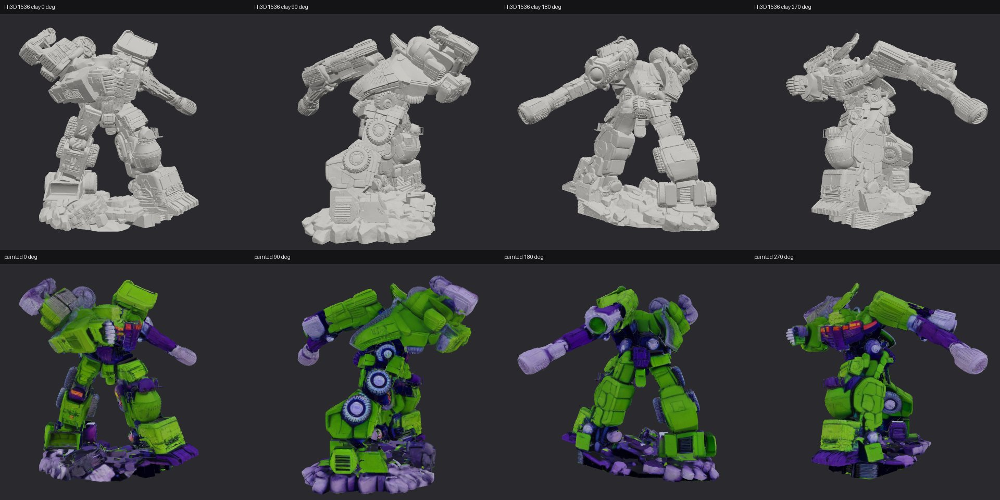

# Mechanical Atelier（机械工坊）

[English](README.md) | **简体中文**

一个仓库内包含三个互相独立的 Blender 作品：地铁车站与列车、擎天柱（Optimus Prime）同人模型、
大力神（Devastator）白模雕塑。其中地铁和擎天柱另配有 Three.js 交互页面。每个任务目录各自包含
页面、JavaScript、样式、源素材、Blender 脚本、交付物和文档；依赖与部署配置在仓库根目录共享。

## 任务一览

| 任务 | 交互入口 | 视频 | 文档 |
| --- | --- | --- | --- |
| 地铁 / Central 站 & M01 列车 | [metro/index.html](metro/index.html) | [metro/watch.html](metro/watch.html) | [地铁 README](metro/README.md) |
| 擎天柱 / 金属质感 V3 | [optimus/index.html](optimus/index.html) | [optimus/watch.html](optimus/watch.html) | [擎天柱 README](optimus/README.md) |
| 大力神 / 白模 V2 | —（仅 Blender + GLB） | [360° 环绕](devastator/v2/deliverables/devastator-v2-360.mp4) · [18 秒合体动画](devastator/v2/deliverables/devastator-v2-assembly.mp4) | [大力神 README](devastator/README.md) |

## 效果截图

截图存放在 `docs/screenshots/`，包括各任务 Blender 渲染图、视频联络表的缩小版，以及 Three.js 交互页面截图；
原始高分辨率文件在各任务的 `deliverables/` 目录中。

### 地铁 / Central 站 & M01 列车

原创岛式站台车站与单节 M01 地铁列车（Cycles 渲染）。

| 车站全景 | 站台 | 列车外观 |
| --- | --- | --- |
|  |  |  |
| **客室内景** | **司机室** | |
|  |  | |

交互页面（[metro/index.html](metro/index.html)，Three.js）：

| 站台视角 | 全景 360° |
| --- | --- |
|  |  |
| **进入车厢** | **进入驾驶室** |
|  |  |

视频：[80 秒分镜预览](metro/deliverables/metro-storyboard-preview.mp4)

### 擎天柱 / 金属质感 V3

G1 风格同人作品，机器人形态与平头卡车形态共用同一套可动网格。

| 机器人形态 | 卡车形态 |
| --- | --- |
|  |  |

交互页面（[optimus/index.html](optimus/index.html)，Three.js）：

| 360° 展示 | 拆解爆炸图 | 卡车形态 |
| --- | --- | --- |
|  |  |  |

视频：[80 秒变形展示](optimus/deliverables/optimus-showcase.mp4)

### 大力神 / 白模 V2

合体形态白模雕塑，610,432 个三角面，Cycles 1600 × 1200 渲染。该任务没有 Three.js 交互页面。

| 主视角 | 正面 | 背面 |
| --- | --- | --- |
|  |  |  |


| 360° 环绕（12 帧解码抽样） | 18 秒合体动画（解码抽帧） |
| --- | --- |
|  |  |

视频：[12 秒 360° 环绕](devastator/v2/deliverables/devastator-v2-360.mp4) ·
[18 秒模块合体](devastator/v2/deliverables/devastator-v2-assembly.mp4)

**实验：用 Hi3D v1.0 从参考生成几何。** 用 4 帧参考视频经 Hunyuan3D-2mv 出粗模，再由 Hi3D 1536 细化（只有几何）。
四个方向的轮廓都与参考一致，但细小零件会丢失，结果是一整块未经编辑的网格。详见 [devastator/hi3d](devastator/hi3d/README.md)。


再用 Qwen-Image-Edit 做 G1 配色概念图，经 Hunyuan3D-2 Paint 上色（[360° 视频](devastator/hi3d/deliverables/devastator-hi3d-color-360.mp4)）：



## 目录结构

```text
metro/
  index.html, film.html, watch.html
  src/
  assets/
  scripts/
  deliverables/
  README.md, QA.md, VIDEO.md, PR_DRAFT.md
optimus/
  index.html, watch.html
  src/
  assets/
  scripts/
  deliverables/
  README.md, QA.md
devastator/
  README.md, REFERENCE.md
  references/            用户提供的参考图与参考视频
  hi3d/                  Hi3D v1.0 几何 + 上色实验（截图、视频、GLB、脚本）
  v2/
    scripts/, assets/, deliverables/, qa/
    README.md, ASSEMBLY.md, QA.md, PROMPTS.md, MCP_SETUP.md
docs/screenshots/        README 截图
public/favicon.svg
scripts/check_deployment.mjs
tests/layout.test.js
package.json, package-lock.json, vite.config.js
```

根目录下的 HTML 文件只是兼容跳转页，不是重复的应用。根页面仍然打开地铁页面；旧链接
`/film.html`、`/watch.html`、`/optimus.html`、`/optimus-watch.html` 会跳转到新的任务页面，
启用 JavaScript 时会保留查询参数和锚点。

## 本地开发

在仓库根目录执行：

```sh
npm ci
npm run dev -- --port 5193
```

打开 `http://127.0.0.1:5193/metro/` 或 `http://127.0.0.1:5193/optimus/`（端口可自选）。
交互页面需要 HTTP 和 WebGL，不能用 `file://` 直接打开；纯视频页面不需要 WebGL。

## 构建与验证

```sh
npm test
npm run build
npm run verify:deploy
npm run preview -- --port 5193
```

也可以只跑单个任务的测试：`npm run test:metro`、`npm run test:optimus`。部署检查会验证全部十个页面入口、
manifest 引用的每个 chunk、CSS 和素材，以及运行时模型、骨骼数据、视频和视频封面的哈希。

发布时请完整上传 `dist/` 目录，不要打平子目录。构建使用相对 URL，可以部署在域名根路径，也可以部署在
`/blender-metro-demo/` 这样的子路径下，无需 SPA 回退或路由重写。服务器需要以 `video/mp4` 提供 MP4，
并支持 HTTP Range 请求（`206 Partial Content`），否则拖动进度条时视频可能跳回开头。

检查本地预览或已部署站点：

```sh
npm run verify:deploy -- --url http://127.0.0.1:5193/
npm run verify:deploy -- --url https://example.com/blender-metro-demo/
```

该检查会通过 HTTP 逐个验证产出文件和两段视频的 Range 响应，不会发布或修改远端站点。
`.blend` 源文件、构建脚本和文档只保存在 Git 中，不会被复制到部署站点。仓库不会自动部署，
请在上述检查通过后再按既定发布流程部署。

## Blender 素材

```sh
/Applications/Blender.app/Contents/MacOS/Blender --background --factory-startup \
  --python-exit-code 1 --python metro/scripts/build_metro.py -- --render
/Applications/Blender.app/Contents/MacOS/Blender --background --factory-startup \
  --python-exit-code 1 --python metro/scripts/build_station.py -- --render
/Applications/Blender.app/Contents/MacOS/Blender --background --factory-startup \
  --python-exit-code 1 --python optimus/scripts/build_optimus.py -- --render
/Applications/Blender.app/Contents/MacOS/Blender --background --factory-startup \
  --python-exit-code 1 --python optimus/scripts/audit_motion.py
python3 metro/scripts/check_assets.py
```

大力神只有 Blender 流程（没有 Three.js 页面，也不在 `npm test` 中）。完整的构建、渲染与审计步骤见
[devastator/v2/README.md](devastator/v2/README.md) 和 [devastator/v2/ASSEMBLY.md](devastator/v2/ASSEMBLY.md)，例如：

```sh
/Applications/Blender.app/Contents/MacOS/Blender --background --factory-startup \
  --python-exit-code 1 --python devastator/v2/scripts/build_assembly.py
```

每个脚本根据自身位置推导所属任务目录，只写入该任务的 `assets/` 和 `deliverables/`。
重新生成模型不会自动重新生成 MP4；模型几何或动画变化后需要重新导出对应视频。
