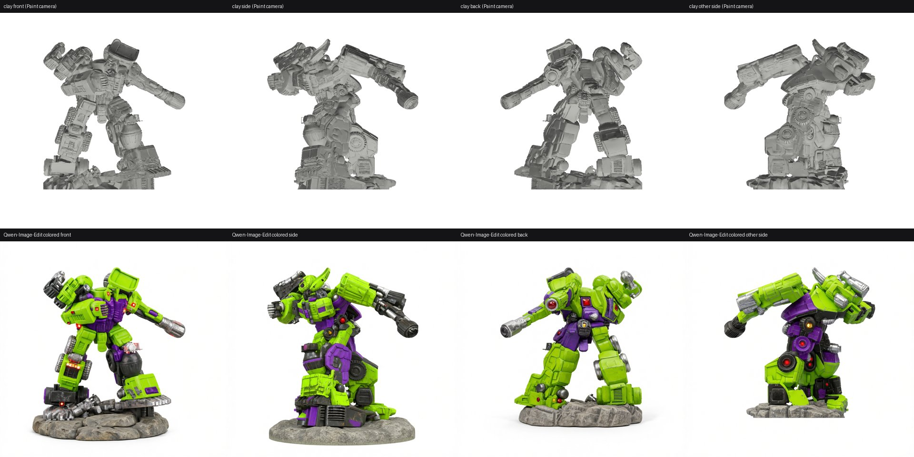
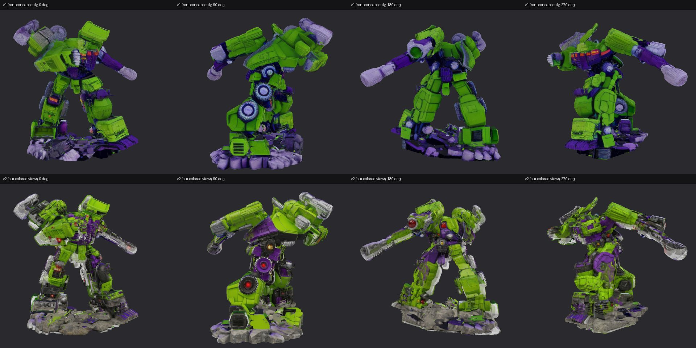
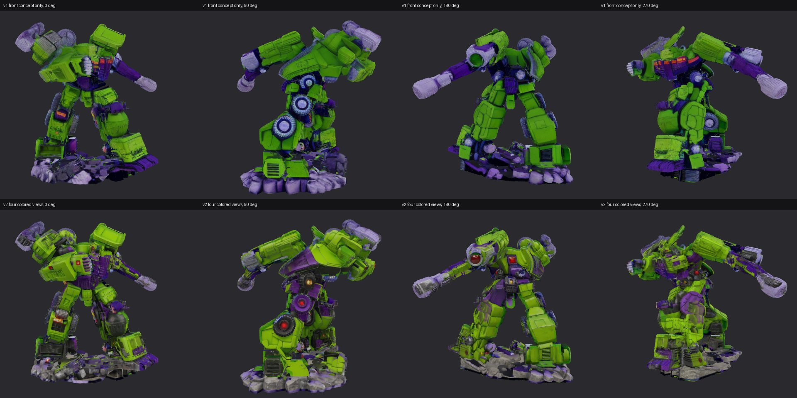
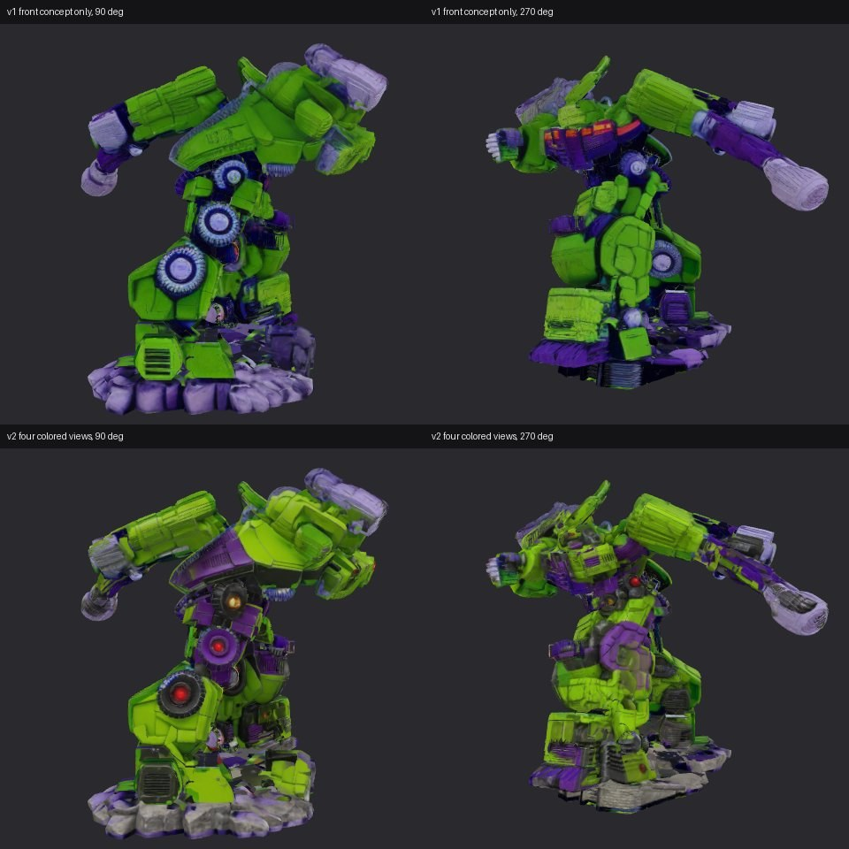

# Devastator / Hi3D v1.0 Geometry and Color Study

[简体中文](README.md) | **English**

Devastator geometry generated from the reference images and turntable video with
**Hunyuan3D-2 (coarse mesh) + Hi3D v1.0 (geometry refinement)**. Geometry run on 2026-10-27; [color](#color-qwen-image-edit--hunyuan3d-2-paint) added 2026-10-28.
Both on one 48 GB L40S (AWS g6e.xlarge, Tokyo). Method and environment fixes follow the
[oss-image-models-lab Hi3D evaluation](https://github.com/liangruibupt/oss-image-models-lab#-hi3d-v10图像--3d-几何细化).

## Findings

- **A multi-view coarse mesh is what makes it work.** Four turntable frames about 90° apart, fed to
  Hunyuan3D-2mv, give a coarse mesh that matches the reference from every side: raised cannon,
  staggered stance, mixer drum, truck cab, tracks and wheel sets all land in roughly the right place.
  With one front image (Hunyuan3D-2mini) the front reads well, but the back and sides are invented and the pose drifts.
- **Hi3D refinement is a large visible step.** The coarse mesh looks like melted clay; 1024 adds flat hard
  surfaces, panel seams, tire treads, grilles and fins; 1536 sharpens edges and small raised details.
- **It is not an exact replica.** Thin parts in the reference (four-barrel muzzle, crane cables, track links,
  hydraulic hoses, mesh railings) are averaged into solids or replaced by plausible invented greebles.
  There are no separable parts, so no V2-style assembly animation. The output is one triangle soup
  (2M faces, 271 pieces, not watertight) that needs retopology/repair before editing, printing or painting.
- **Use it as** a fast high-poly sculpt that resembles the reference (stills, 360° video, concept review,
  a starting point for painting or retopology), not as a replacement for V2's part-by-part editable, animatable model.

## Reference vs Hi3D (matching angles)

Row 1: reference video frames (background removed). Row 2: multi-view coarse + Hi3D 1536.
Row 3: single-view coarse + Hi3D 1536. All meshes use one matte grey material, not textures.

## Refinement stages (upper-body close-up, multi-view)

## 360° turntable

[devastator-hi3d-360.mp4](deliverables/devastator-hi3d-360.mp4): 12 s, 1280 × 720, 24 fps, multi-view + Hi3D 1536 clay.

## Intermediate comparisons

Coarse: single view vs two multi-view frame assignments

The reference turntable's rotation direction is not recorded, so both left/right assignments were tried
(mvA: left = frame 6; mvB: left = frame 18). mvB has a more coherent cannon and back and was used for 1536.

1024: single view vs multi-view (mvA)

Multi-view mvB: coarse vs 1024

## Measurements

| Run | Input | Time | Peak VRAM | Output (verts / faces / pieces) |
| --- | --- | --- | --- | --- |
| Single-view coarse + Hi3D 1024 | `rex-hsu-b-0001.jpg` | 589 s (incl. coarse) | 11.7 GB | 494K / 1.0M / 1,822 |
| Multi-view coarse mvA / mvB | video frames 00/06/12/18 | 34 s inference (+1–2 min load) | — | 809K / 1.6M; 738K / 1.5M |
| mvA → Hi3D 1024 | coarse + frame 00 | 438 s | 13.2 GB | 499K / 1.0M |
| mvB → Hi3D 1024 | coarse + frame 00 | 429 s | 9.8 GB | 499K / 1.0M / 204 |
| mvB → Hi3D 1536 | coarse + frame 00 | 613 s | 19.5 GB | 999K / 2.0M / 271 |
| Single view → Hi3D 1536 | coarse + `rex-hsu-b-0001` | 643 s | 23.6 GB | 993K / 2.0M / 910 |

All with `--sequential-cpu-offload`. Peak VRAM is sampled every 30 s and may undercount. No mesh is watertight.
The whole session (setup, ~70 GB of weights, 7 runs, renders) took about 1.5 hours; the instance was then terminated.

## Generated meshes (GLB)

All 8 meshes are in [`models/`](models/) (~207 MB total, not watertight; all untextured grey except the last):

| File | What | Size |
| --- | --- | --- |
| [`sv_coarse.glb`](models/sv_coarse.glb) | Single-view coarse (Hunyuan3D-2 mini) | 15 MB |
| [`sv_refined_1024.glb`](models/sv_refined_1024.glb) | Single view → Hi3D 1024 | 18 MB |
| [`sv_refined_1536.glb`](models/sv_refined_1536.glb) | Single view → Hi3D 1536 | 36 MB |
| [`mvA_coarse.glb`](models/mvA_coarse.glb) | Multi-view coarse mvA (Hunyuan3D-2mv) | 29 MB |
| [`mvA_refined_1024.glb`](models/mvA_refined_1024.glb) | mvA → Hi3D 1024 | 18 MB |
| [`mvB_coarse.glb`](models/mvB_coarse.glb) | Multi-view coarse mvB | 27 MB |
| [`mvB_refined_1024.glb`](models/mvB_refined_1024.glb) | mvB → Hi3D 1024 | 18 MB |
| [`mvB_refined_1536.glb`](models/mvB_refined_1536.glb) | **mvB → Hi3D 1536 (recommended)** | 36 MB |
| [`mvB_1536_painted_150k.glb`](models/mvB_1536_painted_150k.glb) | mvB 1536 decimated to 150k + Paint color (2048² texture) | 10 MB |

The inputs are Rex Hsu's reference artwork (see [`../REFERENCE.md`](../REFERENCE.md)); these meshes are
derivative content published for technical documentation only. Confirm rights before redistributing or
using them commercially.

## Reproduce

Scripts are in [`scripts/`](scripts/); run them in order:

1. `launch_gpu.py`: launch a g6e.xlarge with boto3 (dedicated key pair and security group).
2. `chain.sh` (calls oss-image-models-lab's `hi3d_env.sh` and `hunyuan_env.sh`): install, pin
   `diffusers==0.31.0` and `huggingface-hub==0.28.1`, pre-download Hi3D, Hunyuan3D-2mini and Hunyuan3D-2mv with
   `HF_HUB_DISABLE_SYMLINKS=1`, and dereference leftover symlinks (Hi3D's loader rejects them).
3. `prep_inputs.py`: sample 24 frames from the reference video, remove backgrounds, crop to centred 1024 × 1024 RGBA.
4. `runs1.sh`: single-view 1024, two multi-view coarse meshes (`coarse_mv.py`) and their 1024 refinements.
5. `runs2.sh`: 1536 refinement for mvB and the single view.
6. `render_clay.py`, `final_assets.py`: comparison sheets, close-ups and the 360° video.

Terminate the instance and delete `devastator-hi3d-key` and `devastator-hi3d-sg` afterwards.

## Color (Qwen-Image-Edit + Hunyuan3D-2 Paint)

Added 2026-10-28. The references are grey clay with no color, so this takes two steps:

1. **Colored concept image**: [Qwen-Image-Edit-2511](https://huggingface.co/Qwen/Qwen-Image-Edit-2511) repaints
   reference frame 00 (the same front view mvB was refined against) in the G1 Devastator scheme: lime-green armor,
   purple joints, silver barrels, red eyes, with pose and structure kept.
2. **Texture**: decimate the mvB 1536 mesh (2M faces) to 150k faces, then Hunyuan3D-2 Paint runs multi-view diffusion
   conditioned on the concept and bakes one 2048 × 2048 UV color texture into a textured GLB.

Row 1: reference frame, concept, baked UV texture, painted close-up. Row 2: painted mesh at 0/90/180/270°.

Hi3D clay (top) vs painted (bottom) at matching angles:

360° color turntable: [devastator-hi3d-color-360.mp4](deliverables/devastator-hi3d-color-360.mp4) (12 s, 1280 × 720, 24 fps).
Painted mesh: [`models/mvB_1536_painted_150k.glb`](models/mvB_1536_painted_150k.glb) (10 MB, 150k faces + 2048² texture).

**Observations**

- **The front is best**: the large color regions (green armor, purple torso and joints, silver barrels, red lights)
  match the concept and read clearly as G1 Devastator.
- **Sides and back are inferred**: the concept covers only the front, so Paint's multi-view diffusion fills in the other
  sides. It keeps the green/purple scheme, but regions are less accurate than the front, with smears and seams.
- **Detail is soft**: at 150k faces the texture carries large color regions only, with no paint lines or weathering;
  colors of small parts often bleed into neighbors. The UVs are xatlas auto-unwrap fragments, not hand-editable.
- **Use it as** a concept / color-scheme preview for stills and turntables, not finished figure paintwork.
- The rock base came out purple because the concept image painted it purple.

**Measurements (one L40S)**

| Step | Time | Peak VRAM |
| --- | --- | --- |
| Qwen-Image-Edit-2511 concept (1024², 40 steps, model CPU offload) | 807 s incl. swapping (+555 s first load) | 39.1 GB |
| Decimate 2M → 150k + Paint load | 189 s load | — |
| Hunyuan3D-2 Paint (multi-view diffusion + bake) | 210 s | 9.7 GB |

g6e.xlarge has only 30 GB RAM; offloading the 20B Qwen-Image-Edit model needed a 96 GB swap file on NVMe.
The session took about 45 minutes; the instance was then terminated.

**Reproduce**: scripts in [`scripts/paint/`](scripts/paint/): `chain_paint.sh` (runs `prelude.sh` for swap + apt; needs
oss-image-models-lab's `hi3d_env.sh`, `hunyuan_env.sh`, `paint_env.sh`) → `color_concept.py` → `run_paint.sh`
(`paint_devastator.py`) → `render_color.py`.

## Color v2: four colored views (experiment, does not replace v1)

Added 2026-10-28 so the sides and back get a real color reference instead of being guessed by Paint.

1. **Clay views**: render the mvB 150k-face mesh as grey clay from Hunyuan3D-2 Paint's own cameras (front, left,
   back, right) with `mv_prepare.py`.
2. **Per-view recolor**: Qwen-Image-Edit-2511 repaints each clay view in the G1 scheme (`mv_edit.py`). Only the clay view
   is passed as an image; the scheme is described in text. Passing the front concept as a second image made the model
   copy the front pose onto the back view, so that was dropped (see
   [`images/mv/color/color_180_twoimg_rejected.png`](images/mv/color/color_180_twoimg_rejected.png)).
3. **Bake**: back-project the four colored views into the UV texture.
   - **v2a** (`mv_bake.py`): plain back-projection. The edit model shifts each outline a few percent, so background white
     was baked onto arm and barrel edges as white streaks. Stretching each view's bounding box to the silhouette made
     overlap worse (front 0.79→0.65, back 0.89→0.73) and was dropped.
   - **v2b** (`mv_bake2.py`): bakes only pixels that both the clay silhouette and the colored view treat as foreground,
     eroded about 1% inward; uncovered regions are filled at low weight from Paint's own pixel-aligned multiview images.

Clay inputs and colored views:

v1 (front concept only) vs v2a and v2b:

Side close-up (top: v1, bottom: v2b; left 90°, right 270°):

**Observations**

- **v2b removes the white streaks.**
- **The 90° side improves**: purple waist and joints, dark wheels, and a grey stone base (v1's rocks were purple); the
  color regions follow the real structure. The two red lights on the wheel hubs were invented by the edit model.
- **The 270° side is messier than v1**: green and purple break into small patches, with a large purple disc on the thigh.
  This view has the best silhouette overlap (0.98), so the likely cause is that its colors disagree with the neighbouring
  front and back views where they overlap and get averaged together, not misalignment.
- **Thin parts**: the barrels are still partly v1's pale purple, because thin parts are where the colored views are trimmed
  most and Paint's fill shows through.
- **Verdict**: v2b does not beat v1 overall, so v1 (`mvB_1536_painted_150k.glb`) stays the main version; v2 is kept as an
  experiment record. A likely fix is to bake each view only into the region it faces, so overlaps are not averaged.

**Outputs**

| File | Notes |
| --- | --- |
| [`models/mvB_1536_painted_mv_v2a.glb`](models/mvB_1536_painted_mv_v2a.glb) | v2a plain back-projection (white streaks), 10.9 MB |
| [`models/mvB_1536_painted_mv_v2b.glb`](models/mvB_1536_painted_mv_v2b.glb) | v2b masked bake, 10.7 MB |
| [`deliverables/devastator-hi3d-color-mv-v2a-360.mp4`](deliverables/devastator-hi3d-color-mv-v2a-360.mp4) | v2a 360° video |
| [`deliverables/devastator-hi3d-color-mv-v2b-360.mp4`](deliverables/devastator-hi3d-color-mv-v2b-360.mp4) | v2b 360° video |
| [`images/mv/`](images/mv/) | Intermediates: clay views `clay/`, colored views `color/`, Paint multiview `paint-multiview/`, bake inputs `bake-v2a/` `bake-v2b/`, UV textures `albedo_v2a.png` `albedo_v2b.png`, camera check images |

**Measurements (one L40S)**

| Step | Time | Peak VRAM |
| --- | --- | --- |
| Paint multiview (cameras + fill) | — | 9.7 GB |
| Qwen-Image-Edit-2511 per-view recolor (1024²) | 562-729 s per view | 39.1-39.5 GB |

**Reproduce**: scripts in [`scripts/paint-mv/`](scripts/paint-mv/): `chain_mv.sh` (envs → `mv_prepare.py` → `mv_edit.py`
→ `mv_bake.py` → `mv_render.py`); `chain_mv2.sh` resumes from the recolor step; v2b is `mv_bake2.py` + `mv_render2.py`.
Run logs are in [`scripts/paint-mv/logs/`](scripts/paint-mv/logs/).

## Next steps (not done)

- **Per-view region bake**: bake each colored view only into the region it faces, so overlaps are not averaged (the v2b 270° problem).
- **View selection**: Hunyuan3D-2mv takes at most front/left/back/right; try other frame sets and seeds.
- **Retopology**: bake the 2M-face mesh to a low-poly + normal map with oss-image-models-lab's `blender_retopo_bake.py`
  before painting; detail will hold up better than plain decimation.
