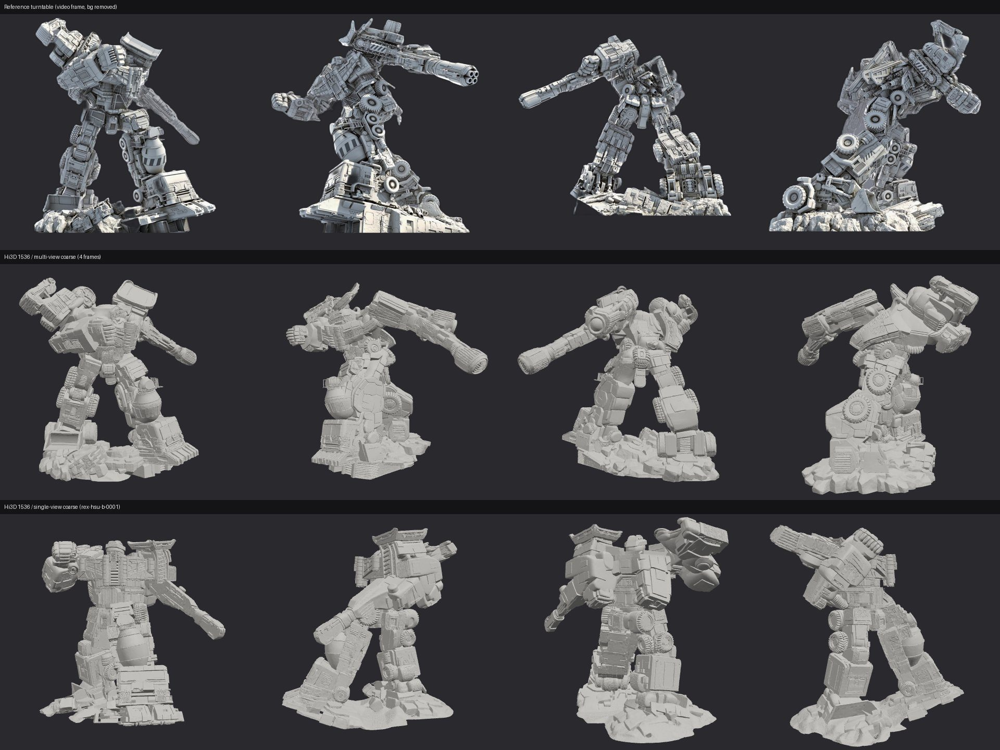
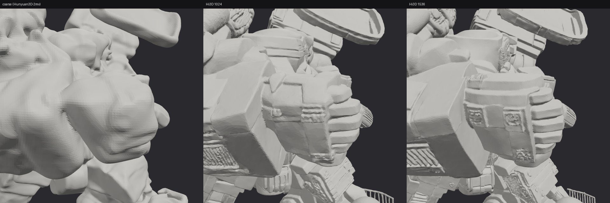
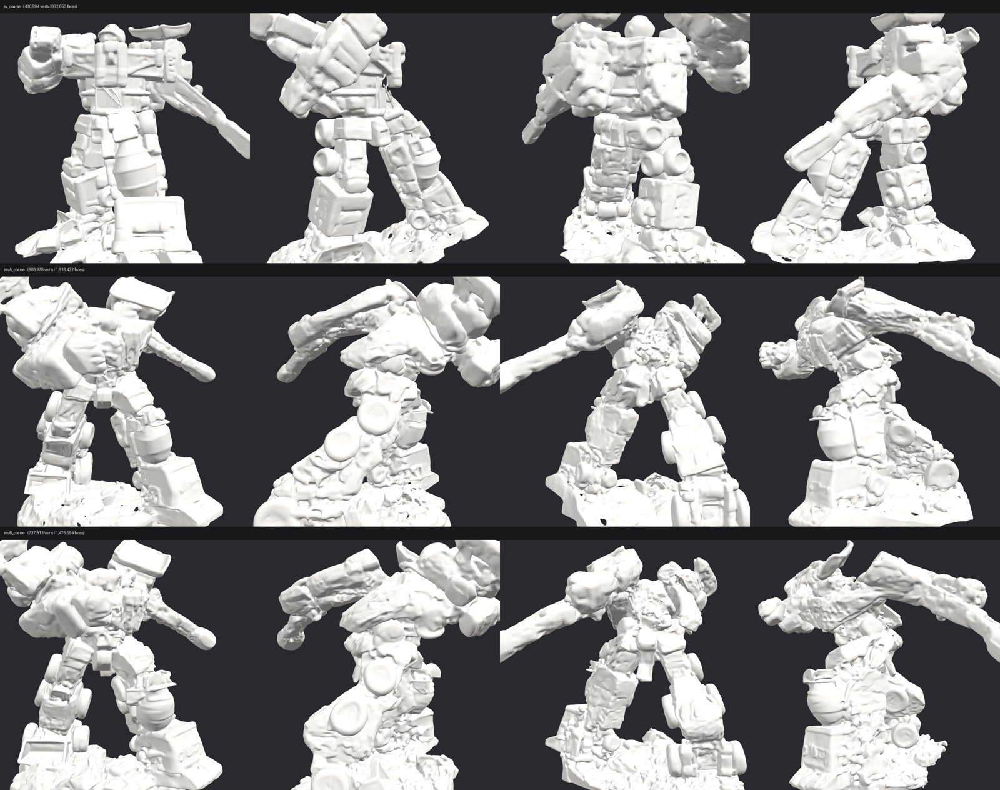
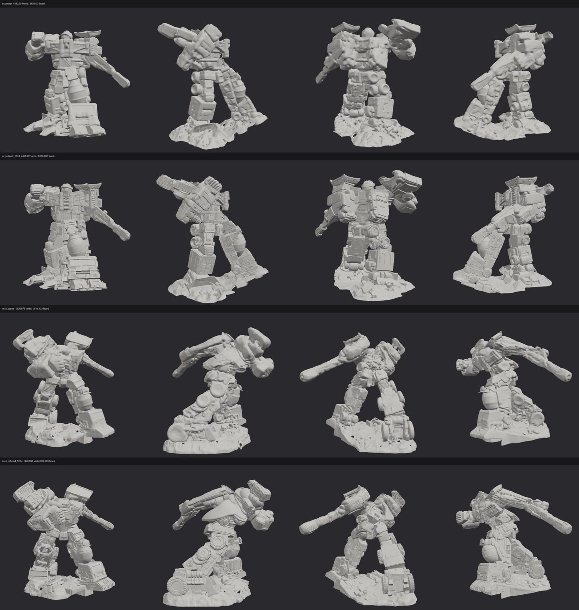
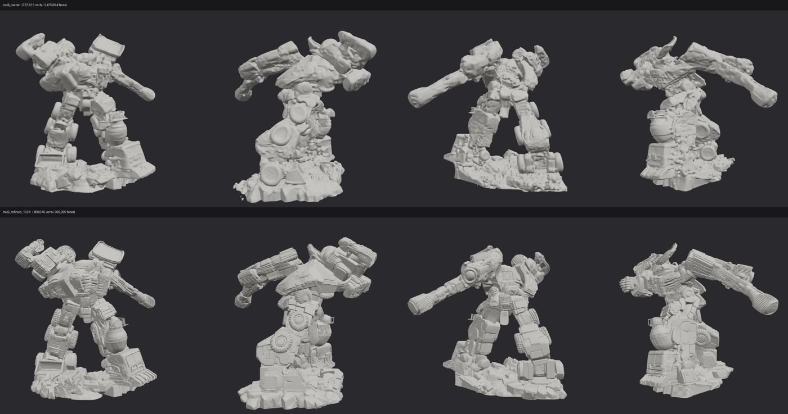

# 大力神 / Hi3D v1.0 几何复刻实验

**简体中文** | [English](README.en.md)

用 **Hunyuan3D-2（粗模）+ Hi3D v1.0（几何细化）** 从参考图和参考视频生成大力神的 3D 几何。
**只做几何、不上色**。实验时间 2026-10-27，单张 L40S 48 GB（AWS g6e.xlarge，东京）。
评测方法与环境踩坑沿用 [oss-image-models-lab 的 Hi3D 评测](https://github.com/liangruibupt/oss-image-models-lab#-hi3d-v10图像--3d-几何细化)。

## 结论

- **多视图粗模是关键。** 从参考视频抽 4 帧（相隔约 90°）喂给 Hunyuan3D-2mv，得到的粗模四个方向都与参考一致：
  斜举的炮管、交错的站姿、搅拌罐、车头、履带和轮组都在大致正确的位置。
  只用一张正面图（Hunyuan3D-2mini）时，正面像，但背面和侧面是模型“合理补全”的，姿态也与参考不符。
- **Hi3D 细化效果明显。** 粗模表面坑洼、像融化的泥；1024 后出现平整的硬表面、面板分缝、轮胎胎纹、
  格栅和散热片；1536 棱角更锐利，嵌板上的小凸起和线槽更清楚。
- **但它不是“精确复刻”。** 参考里细小的结构（四管炮口、吊臂钢索、履带链节、液压管、网格扶手）
  要么被平均成一个实心体，要么变成模型自己“编”的类机械纹理；没有可分离的零件，也做不了 V2 那样的组装动画。
  网格是单一的三角汤（2M 面、271 个碎块、非水密），要进 Blender 编辑、打印或上色都需先重拓扑/修复。
- **定位：** 适合快速得到一个“像参考”的高模雕塑底稿（静态展示、360° 视频、概念评审、后续上色或重拓扑的起点），
  不能替代 V2 那种逐零件建模的可编辑、可动画模型。

## 参考 vs Hi3D（同一角度）

第一行是参考视频帧（去背景），第二行是多视图粗模 + Hi3D 1536，第三行是单视图粗模 + Hi3D 1536。
渲染是统一的灰色哑光材质，不是贴图。

## 细化逐级对比（上半身特写，多视图）

## 360° 环绕视频

[devastator-hi3d-360.mp4](deliverables/devastator-hi3d-360.mp4)：12 秒，1280 × 720，24 fps，多视图 + Hi3D 1536 灰模。

## 过程对比图

粗模：单视图 vs 两种多视图帧分配

参考转台的旋转方向没有记录，所以对左右两帧做了两种分配（mvA：左=第 6 帧；mvB：左=第 18 帧）。
mvB 的炮管和背部更连贯，后续 1536 用 mvB。

1024：单视图 vs 多视图（mvA）

多视图 mvB：粗模 vs 1024

## 实测数据

| 运行 | 输入 | 耗时 | 峰值显存 | 输出（顶点 / 面 / 碎块） |
| --- | --- | --- | --- | --- |
| 单视图粗模 + Hi3D 1024 | `rex-hsu-b-0001.jpg` | 589 s（含粗模） | 11.7 GB | 494K / 1.0M / 1,822 |
| 多视图粗模 mvA / mvB | 视频帧 00/06/12/18 | 34 s 推理（加载约 1–2 分钟） | — | 809K / 1.6M；738K / 1.5M |
| mvA → Hi3D 1024 | 粗模 + 帧 00 | 438 s | 13.2 GB | 499K / 1.0M |
| mvB → Hi3D 1024 | 粗模 + 帧 00 | 429 s | 9.8 GB | 499K / 1.0M / 204 |
| mvB → Hi3D 1536 | 粗模 + 帧 00 | 613 s | 19.5 GB | 999K / 2.0M / 271 |
| 单视图 → Hi3D 1536 | 粗模 + `rex-hsu-b-0001` | 643 s | 23.6 GB | 993K / 2.0M / 910 |

均启用 `--sequential-cpu-offload`。峰值显存按 30 秒采样，可能略低于真实峰值。全部网格都不是水密的。
整个会话（装环境、下约 70 GB 权重、7 次运行、出图）约 1.5 小时，实例随后已终止。

## 什么没有放进仓库

**生成的网格（GLB）没有提交。** 输入来自 Rex Hsu 的参考作品（见 [`../REFERENCE.md`](../REFERENCE.md)），
没有再分发授权；从这些图直接生成的 3D 模型属于衍生内容，放进公开仓库风险比渲染截图更高。
截图和视频用于说明实验结果。完整网格（粗模、1024、1536 共 8 个，约 200 MB）保存在执行实验的
Kiro Crew 主机上（`/home/ubuntu/workplace/devastator-hi3d-run/out/`，不在 Git 中），确认授权后可以再补交或改用自己的原创参考重跑。

## 复现

脚本在 [`scripts/`](scripts/)，在 GPU 实例上按顺序运行：

1. `launch_gpu.py`：用 boto3 启动 g6e.xlarge（独立 key pair 与安全组）。
2. `chain.sh`（调用 oss-image-models-lab 的 `hi3d_env.sh`、`hunyuan_env.sh`）：装环境，锁定
   `diffusers==0.31.0`、`huggingface-hub==0.28.1`，以 `HF_HUB_DISABLE_SYMLINKS=1` 预下载 Hi3D、
   Hunyuan3D-2mini、Hunyuan3D-2mv 权重，并解引用残留符号链接（Hi3D 加载器拒绝 symlink）。
3. `prep_inputs.py`：从参考视频均匀抽 24 帧，rembg 去背景，裁成居中的 1024 × 1024 RGBA。
4. `runs1.sh`：单视图 1024 + 两种多视图粗模（`coarse_mv.py`）+ 1024 细化。
5. `runs2.sh`：mvB 和单视图的 1536 细化。
6. `render_clay.py`、`final_assets.py`：对比图、特写、360° 视频。

用完务必终止实例，并删除 `devastator-hi3d-key` 和 `devastator-hi3d-sg`。

## 下一步（未做）

- **上色**：参考是灰模，没有颜色信息。需先做一张彩色概念图（例如 G1 绿紫涂装），再减面并用 Hunyuan3D-Paint 生成 UV 贴图。
- **更多视角**：Hunyuan3D-2mv 最多接受前/左/后/右 4 张；可以尝试不同帧组合或多个 seed，挑最接近参考的粗模。
- **重拓扑**：用 oss-image-models-lab 的 `blender_retopo_bake.py` 把 2M 面高模烘成低模 + 法线贴图，便于在 Blender 里编辑和渲染。
