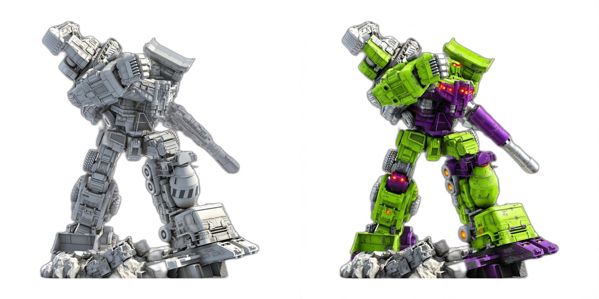
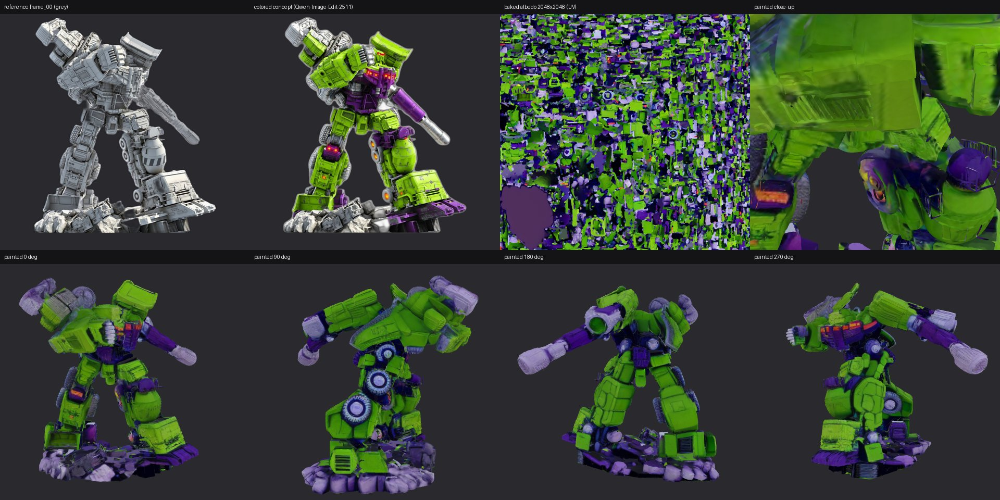

# 大力神 / Hi3D v1.0 几何复刻与上色实验

**简体中文** | [English](README.en.md)

用 **Hunyuan3D-2（粗模）+ Hi3D v1.0（几何细化）** 从参考图和参考视频生成大力神的 3D 几何。
几何实验于 2026-10-27，[上色](#上色qwen-image-edit--hunyuan3d-2-paint)于 2026-10-28 补做，单张 L40S 48 GB（AWS g6e.xlarge，东京）。
评测方法与环境踩坑沿用 [oss-image-models-lab 的 Hi3D 评测](https://github.com/liangruibupt/oss-image-models-lab#-hi3d-v10图像--3d-几何细化)。

## 结论

- **多视图粗模是关键。** 从参考视频抽 4 帧（相隔约 90°）喂给 Hunyuan3D-2mv，得到的粗模四个方向都与参考一致：
  斜举的炮管、交错的站姿、搅拌罐、车头、履带和轮组都在大致正确的位置。
  只用一张正面图（Hunyuan3D-2mini）时，正面像，但背面和侧面是模型“合理补全”的，姿态也与参考不符。
- **Hi3D 细化效果明显。** 粗模表面坑洼、像融化的泥；1024 后出现平整的硬表面、面板分缝、轮胎胎纹、
  格栅和散热片；1536 棱角更锐利，嵌板上的小凸起和线槽更清楚。
- **但它不是“精确复刻”。** 参考里细小的结构（四管炮口、吊臂钢索、履带链节、液压管、网格扶手）
  要么被平均成一个实心体，要么变成模型自己“编”的类机械纹理；没有可分离的零件，也做不了 V2 那样的组装动画。
  网格是单一的三角汤（2M 面、271 个碎块、非水密），要进 Blender 编辑、打印或上色都需先重拓扑/修复。
- **定位：** 适合快速得到一个“像参考”的高模雕塑底稿（静态展示、360° 视频、概念评审、后续上色或重拓扑的起点），
  不能替代 V2 那种逐零件建模的可编辑、可动画模型。

## 参考 vs Hi3D（同一角度）

第一行是参考视频帧（去背景），第二行是多视图粗模 + Hi3D 1536，第三行是单视图粗模 + Hi3D 1536。
渲染是统一的灰色哑光材质，不是贴图。

## 细化逐级对比（上半身特写，多视图）

## 360° 环绕视频

[devastator-hi3d-360.mp4](deliverables/devastator-hi3d-360.mp4)：12 秒，1280 × 720，24 fps，多视图 + Hi3D 1536 灰模。

## 过程对比图

粗模：单视图 vs 两种多视图帧分配

参考转台的旋转方向没有记录，所以对左右两帧做了两种分配（mvA：左=第 6 帧；mvB：左=第 18 帧）。
mvB 的炮管和背部更连贯，后续 1536 用 mvB。

1024：单视图 vs 多视图（mvA）

多视图 mvB：粗模 vs 1024

## 实测数据

| 运行 | 输入 | 耗时 | 峰值显存 | 输出（顶点 / 面 / 碎块） |
| --- | --- | --- | --- | --- |
| 单视图粗模 + Hi3D 1024 | `rex-hsu-b-0001.jpg` | 589 s（含粗模） | 11.7 GB | 494K / 1.0M / 1,822 |
| 多视图粗模 mvA / mvB | 视频帧 00/06/12/18 | 34 s 推理（加载约 1–2 分钟） | — | 809K / 1.6M；738K / 1.5M |
| mvA → Hi3D 1024 | 粗模 + 帧 00 | 438 s | 13.2 GB | 499K / 1.0M |
| mvB → Hi3D 1024 | 粗模 + 帧 00 | 429 s | 9.8 GB | 499K / 1.0M / 204 |
| mvB → Hi3D 1536 | 粗模 + 帧 00 | 613 s | 19.5 GB | 999K / 2.0M / 271 |
| 单视图 → Hi3D 1536 | 粗模 + `rex-hsu-b-0001` | 643 s | 23.6 GB | 993K / 2.0M / 910 |

均启用 `--sequential-cpu-offload`。峰值显存按 30 秒采样，可能略低于真实峰值。全部网格都不是水密的。
整个会话（装环境、下约 70 GB 权重、7 次运行、出图）约 1.5 小时，实例随后已终止。

## 生成的网格（GLB）

全部 8 个网格在 [`models/`](models/)（共约 207 MB，非水密；除最后一个外均为无贴图灰模）：

| 文件 | 说明 | 大小 |
| --- | --- | --- |
| [`sv_coarse.glb`](models/sv_coarse.glb) | 单视图粗模（Hunyuan3D-2 mini） | 15 MB |
| [`sv_refined_1024.glb`](models/sv_refined_1024.glb) | 单视图 → Hi3D 1024 | 18 MB |
| [`sv_refined_1536.glb`](models/sv_refined_1536.glb) | 单视图 → Hi3D 1536 | 36 MB |
| [`mvA_coarse.glb`](models/mvA_coarse.glb) | 多视图粗模 mvA（Hunyuan3D-2mv） | 29 MB |
| [`mvA_refined_1024.glb`](models/mvA_refined_1024.glb) | mvA → Hi3D 1024 | 18 MB |
| [`mvB_coarse.glb`](models/mvB_coarse.glb) | 多视图粗模 mvB | 27 MB |
| [`mvB_refined_1024.glb`](models/mvB_refined_1024.glb) | mvB → Hi3D 1024 | 18 MB |
| [`mvB_refined_1536.glb`](models/mvB_refined_1536.glb) | **mvB → Hi3D 1536（推荐）** | 36 MB |
| [`mvB_1536_painted_150k.glb`](models/mvB_1536_painted_150k.glb) | mvB 1536 减到 15 万面 + Paint 上色（带 2048² 贴图） | 10 MB |

输入来自 Rex Hsu 的参考作品（见 [`../REFERENCE.md`](../REFERENCE.md)），这些网格属于衍生内容，
仅用于技术实验说明，再分发或商用前请自行确认授权。

## 复现

脚本在 [`scripts/`](scripts/)，在 GPU 实例上按顺序运行：

1. `launch_gpu.py`：用 boto3 启动 g6e.xlarge（独立 key pair 与安全组）。
2. `chain.sh`（调用 oss-image-models-lab 的 `hi3d_env.sh`、`hunyuan_env.sh`）：装环境，锁定
   `diffusers==0.31.0`、`huggingface-hub==0.28.1`，以 `HF_HUB_DISABLE_SYMLINKS=1` 预下载 Hi3D、
   Hunyuan3D-2mini、Hunyuan3D-2mv 权重，并解引用残留符号链接（Hi3D 加载器拒绝 symlink）。
3. `prep_inputs.py`：从参考视频均匀抽 24 帧，rembg 去背景，裁成居中的 1024 × 1024 RGBA。
4. `runs1.sh`：单视图 1024 + 两种多视图粗模（`coarse_mv.py`）+ 1024 细化。
5. `runs2.sh`：mvB 和单视图的 1536 细化。
6. `render_clay.py`、`final_assets.py`：对比图、特写、360° 视频。

用完务必终止实例，并删除 `devastator-hi3d-key` 和 `devastator-hi3d-sg`。

## 上色（Qwen-Image-Edit + Hunyuan3D-2 Paint）

2026-10-28 补做。参考是灰模、没有颜色信息，所以分两步：

1. **彩色概念图**：用 [Qwen-Image-Edit-2511](https://huggingface.co/Qwen/Qwen-Image-Edit-2511) 把参考视频第 00 帧
   （也是 mvB 细化时用的正面图）重新上色为 G1 大力神涂装：亮绿装甲、紫色关节、银色炮管、红色眼睛，要求姿势和结构不变。
2. **贴图**：把 mvB 1536 网格（200 万面）减到 15 万面，以概念图为条件用 Hunyuan3D-2 Paint
   多视角生成并烘焙一张 2048 × 2048 的 UV 颜色贴图，导出带色 GLB。

第 1 行：参考帧、概念图、烘焙出的 UV 贴图、上色模型特写。第 2 行：上色模型 0/90/180/270°。

同一角度的 Hi3D 灰模（上）与上色模型（下）：

360° 带色环绕视频：[devastator-hi3d-color-360.mp4](deliverables/devastator-hi3d-color-360.mp4)（12 秒，1280 × 720，24 fps）。
上色模型：[`models/mvB_1536_painted_150k.glb`](models/mvB_1536_painted_150k.glb)（10 MB，15 万面 + 2048² 贴图）。

**观察**

- **正面最好**：大块配色（绿色装甲、紫色胸腹和关节、银色炮管、红色灯）和概念图一致，能看出是 G1 大力神。
- **侧面和背面是模型推断的**：概念图只有正面一张，背面和侧面的颜色由 Paint 的多视角扩散补全。整体延续了绿紫配色，
  但分区不如正面准确，局部有颜色涂抹和接缝。
- **细节偏软**：减面到 15 万面后，贴图只能表现大块色区，没有涂装分界线和磨损细节；细小零件颜色常常串到相邻部件。
  贴图是 xatlas 自动展开的碎片 UV，不适合手工修改。
- **定位**：达到"概念展示 / 配色预览"的水平，可用于静帧和环绕视频；不是成品级手办涂装。
- 背景底座（岩石）被涂成了紫色，因为概念图里底座是紫的。

**实测（单张 L40S）**

| 步骤 | 耗时 | 峰值显存 |
| --- | --- | --- |
| Qwen-Image-Edit-2511 概念图（1024²，40 步，model CPU offload） | 807 s（含换页，首次加载另 555 s） | 39.1 GB |
| 减面 2M → 150k + Paint 加载 | 189 s 加载 | — |
| Hunyuan3D-2 Paint（多视角扩散 + 烘焙） | 210 s | 9.7 GB |

g6e.xlarge 只有 30 GB 内存，Qwen-Image-Edit 的 20B 模型 CPU offload 需要在 NVMe 上加 96 GB swap。整个会话约 45 分钟，实例随后已终止。

**复现**：脚本在 [`scripts/paint/`](scripts/paint/)：`chain_paint.sh`（调用 `prelude.sh` 加 swap、装环境；
需要 oss-image-models-lab 的 `hi3d_env.sh`、`hunyuan_env.sh`、`paint_env.sh`）→ `color_concept.py` → `run_paint.sh`
（`paint_devastator.py`）→ `render_color.py`。

## 下一步（未做）

- **多视角概念图**：给背面、侧面也各做一张彩色概念图（同样用参考视频帧），让 Paint 不再靠猜背面颜色。
- **更多视角**：Hunyuan3D-2mv 最多接受前/左/后/右 4 张；可以尝试不同帧组合或多个 seed，挑最接近参考的粗模。
- **重拓扑**：用 oss-image-models-lab 的 `blender_retopo_bake.py` 把 2M 面高模烘成低模 + 法线贴图，再上色，细节会比直接减面好。
